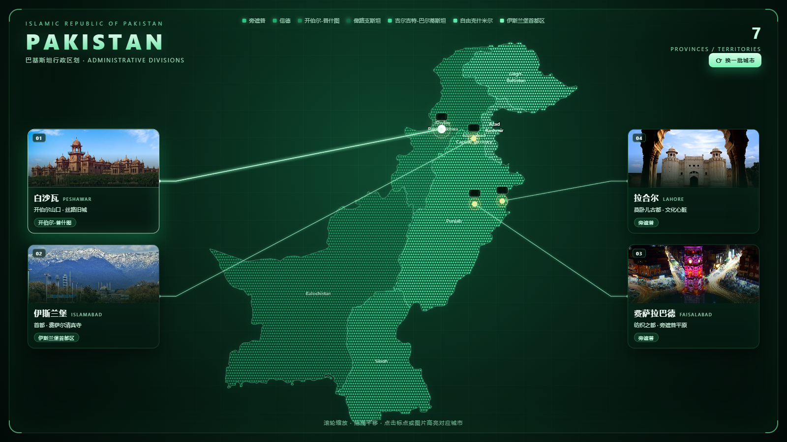

# 巴基斯坦点阵地图 · React + ECharts

基于 Vite + React 18 + ECharts 5 的巴基斯坦行政区划可视化，深绿主题，地图由 8,545 个圆点构成；
随机抽取 4 座城市，用编号标点 + 发光引线连接到左右两列实景图卡片，图片下方给出中英文城市名、特征与省份。



## 运行

```bash
npm install
npm run dev      # 开发，默认 http://localhost:5173
npm run build    # 生产构建，产物在 dist/（base: './'，可直接双击 dist/index.html）
npm run preview  # 预览构建产物
```

## 目录结构

```
pakistan-map-react/
├─ index.html
├─ vite.config.js
├─ package.json
├─ docs/preview.png
├─ public/cities/*.jpg           # 8 座候选城市实景图（本地，离线可用）
└─ src/
   ├─ main.jsx
   ├─ App.jsx                    # 随机城市、左右卡片、引线坐标计算
   ├─ styles.css
   ├─ components/
   │  ├─ PakistanMap.jsx         # 点阵地图 + 城市标点
   │  └─ LeaderLines.jsx         # SVG 引线层
   ├─ hooks/useEchart.js
   └─ data/
      ├─ pakistan.geo.json
      ├─ pakistan.dots.json
      ├─ provinces.js
      └─ cities.js
```

## 地图

- 几何数据来自 geoBoundaries `PAK/ADM1` 简化版（约 159KB），覆盖 7 个省级区域：旁遮普、信德、开伯尔-普什图、俾路支斯坦、吉尔吉特-巴尔蒂斯坦、自由克什米尔、伊斯兰堡首都区。
- 地图内部不是色块填充，而是 8,545 个等距圆点（`pakistan.dots.json`，经纬度网格 step≈0.105°，交错行），按省分 7 组 `scatter` 系列渲染，配合 geo 实现 hover 联动。
- 配色仅作视觉区分，**不代表任何业务数值**；需要按人口 / GDP 着色时，在 `provinces.js` 补水 `value` 并给 scatter 加 `visualMap`。
- 交互：滚轮缩放、拖拽平移、点击选中；容器尺寸变化由 `ResizeObserver` 重绘。

## 标点 · 引线 · 图片卡

- 每批从 8 座候选城市中随机取 4 个；地图上用 `effectScatter` 光点标出位置，配 01–04 编号胶囊标签（带底色描边，标签拥挤时自动错位）。
- 卡片分左右两列，按经度分布到两侧；每张卡片从上到下为：实景图 → 中文名 + 英文名 → 一句特征 → 省份标签。
- 引线取自 `chart.convertToPixel({ geoIndex: 0 }, coord)` 的像素坐标，从卡片朝地图一侧的边缘出发，先水平一小段再斜向标点，端点画圆环。
- 点击卡片或标点双向联动：卡片高亮、引线加粗提亮、标点放大变白。
- 地图尺寸随视口自适应（按两列卡片外宽计算），保证引线不侵入卡片；窗口宽度 < 900px 时卡片改为底部横排并隐藏引线。

| 需求 | 改哪里 |
| --- | --- |
| 加减城市 / 改坐标 / 改简介 | `src/data/cities.js` |
| 改抽取数量 | `src/App.jsx` 的 `CITY_COUNT` |
| 换城市图片 | 覆盖 `public/cities/<slug>.jpg`（与 `cities.js` 的 `img` 对应） |
| 换配色 | `src/data/provinces.js` 的 `color` |
| 换背景 | `src/styles.css` 中 `body` 的 `radial-gradient` |
| 引线样式 | `src/styles.css` 的 `.leader-path` / `.leader-glow` |

候选城市池：卡拉奇、拉合尔、伊斯兰堡、奎达、拉瓦尔品第、费萨拉巴德、白沙瓦、斯卡杜。图片来自维基共享资源，已下载到本地。

## License

MIT
